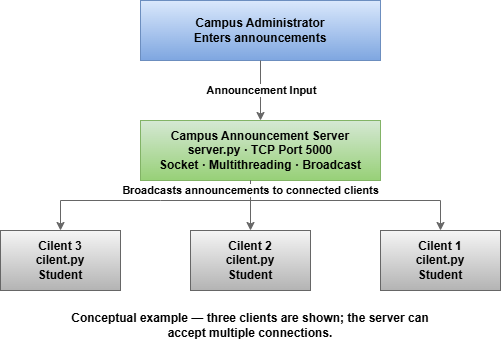

# Campus Announcement System

## 1. Project Overview

The Campus Announcement System is a Python-based client-server application designed to simulate a university announcement service. It allows a campus administrator to send announcements to multiple connected students simultaneously.

The system uses TCP sockets for network communication and multithreading to handle multiple client connections.

## 2. Project Objectives

- Establish communication between one server and multiple clients.
- Implement TCP socket communication using Python.
- Use multithreading to handle multiple client connections.
- Broadcast announcements to all currently connected clients.
- Test the system with multiple clients.

## 3. System Architecture

The system consists of one server and multiple clients connected through TCP sockets.

- **Campus Administrator:** Enters announcements through the server terminal.
- **Server (`Server.py`):** Accepts client connections, manages connected clients, and broadcasts announcements.
- **Clients (`Client.py`):** Connect to the server using TCP, send their usernames, and display received announcements.

Each client connection is handled by a separate thread, allowing the server to manage multiple clients concurrently.



## 4. Technologies Used

- **Python 3:** Main programming language.
- **Socket:** Provides TCP network communication.
- **Threading:** Allows the server to handle multiple client connections concurrently.
- **TCP/IP:** Provides reliable communication between the server and clients.

The `socket` and `threading` modules are included in Python's standard library and do not require separate installation.

## 5. Project Files

- `Server.py`: Creates the server, accepts client connections, and broadcasts announcements.
- `Client.py`: Connects students to the server and receives announcements.
- `README.md`: Provides project documentation and instructions.
- `docs/Dr.png`: Contains the system architecture diagram.

## 6. How the System Works

1. The administrator starts the server program.
2. Each student starts the client program and enters a username.
3. The client establishes a TCP connection with the server.
4. The server creates a separate thread to handle each client connection.
5. The administrator types an announcement in the server terminal.
6. The server broadcasts the announcement to all currently connected clients.
7. Each client displays the received announcement in its terminal.
8. When a client disconnects, the server removes its connection from the active client list.

## 7. How to Run the Program

### Prerequisites

- Python 3 must be installed.
- The project files must be available in the same project directory.

### Step 1: Start the Server

Open a terminal in the project directory and run:

```bash
python Server.py
```

The server will start listening on port `5000`.

### Step 2: Start the Clients

Open a separate terminal window for each client and run:

```bash
python Client.py
```

Enter a username when prompted.

Run multiple client instances to test simultaneous connections.

### Step 3: Send an Announcement

Type an announcement in the server terminal and press Enter.

The server will broadcast the announcement to all currently connected clients.

Example:

```text
Announcement> The campus library will close at 5 PM today.
```

Expected client output:

```text
[CAMPUS ANNOUNCEMENT] The campus library will close at 5 PM today.
```

### Step 4: Stop the Server

Type `/quit` in the server terminal and press Enter to stop the server.

## 8. Testing

The following test cases should be performed to evaluate the system.

| Test Case | Expected Result |
|---|---|
| Connect multiple clients | The server accepts multiple client connections. |
| Broadcast an announcement | All currently connected clients receive the announcement. |
| Enter an empty username | The client displays a validation message and exits. |
| Disconnect a client | The server removes the disconnected client and continues running. |
| Stop the server | The server closes its listening socket and connected client sockets. |

Actual test results should be recorded after executing each test case. Screenshots of the server and client terminals should be included as evidence.

## 9. Limitations

- The current client configuration uses `127.0.0.1`, so the client and server are configured to run on the same computer.
- Connecting clients from other computers requires changing the client host address to the server computer's reachable IP address.
- The system is a basic educational prototype and does not include authentication or encrypted communication.

## 10. Conclusion

The Campus Announcement System demonstrates client-server communication using TCP sockets, multithreading, and broadcasting in Python.

It provides a simple example of how a server can distribute announcements to multiple connected clients in a campus environment.

The project also demonstrates fundamental concepts in parallel and distributed systems, including concurrent client handling and network communication.
